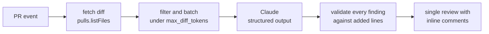

# ai-code-review-action

[](https://github.com/jumilandelapena/ai-code-review-action/actions/workflows/ci.yml)
[](https://github.com/jumilandelapena/ai-code-review-action/actions/workflows/self-review.yml)
[](LICENSE)

A reusable GitHub Action that reviews every pull request with Claude and posts **one** review: inline comments on the exact changed lines, one-click suggestion blocks, a severity table, a verdict, and the token usage and estimated cost of the run. It parses the unified diff itself so it can refuse to comment on lines that did not change, measures every request with the token-counting endpoint before sending it, shares a cached system prompt across batches, never posts the same finding twice on a later push, and runs without an API key in tests and CI through a mock provider. This repository reviews its own pull requests with it.


The screenshot is captured from the live review on [PR #1 (planted off-by-one and a retry around a non-idempotent call)](https://github.com/jumilandelapena/ai-code-review-action/pull/1) with `pnpm screenshot --repo jumilandelapena/ai-code-review-action --pr 1`. A second demo is [PR #2 (planted missing `await` and a per-token price off by 1000×)](https://github.com/jumilandelapena/ai-code-review-action/pull/2). Both PRs stay open on purpose so the reviews can be read.

## Install

```yaml
# .github/workflows/ai-review.yml
name: AI review
on:
  pull_request:
    types: [opened, synchronize, reopened]
  issue_comment:
    types: [created]
permissions:
  contents: read
  pull-requests: write
jobs:
  review:
    if: github.event_name == 'pull_request' || startsWith(github.event.comment.body, '/ai-review')
    runs-on: ubuntu-latest
    steps:
      - uses: actions/checkout@v4
      - uses: jumilandelapena/ai-code-review-action@v1
        with:
          anthropic_api_key: ${{ secrets.ANTHROPIC_API_KEY }}
          github_token: ${{ github.token }}
```

Add `ANTHROPIC_API_KEY` under *Settings → Secrets and variables → Actions*. Comment `/ai-review` on any PR to run it on demand.

## How it works



1. **Trigger.** `pull_request` (`opened`, `synchronize`, `reopened`) or a `/ai-review` comment. PRs from forks are skipped on `pull_request` because they get no secrets and a read-only token.
2. **Fetch.** `pulls.listFiles` with patches. Lock files, binaries, generated output (`dist/**`, `*.min.js`, snapshots, …) and your `ignore` globs are dropped. Reviewing stops at `max_files` and the review says so.
3. **Parse.** Each patch is parsed into hunks; every added line keeps its exact new-file line number. Only those lines can receive inline comments.
4. **Context.** The file at the head SHA is fetched and up to 30 lines around each hunk are shown, labelled as context, not as the diff.
5. **Batch.** Files are packed into requests under `max_diff_tokens`, measured with `messages.countTokens`. The system prompt and guidelines come first with `cache_control: ephemeral`, so batches in the same run share one cached prefix.
6. **Review.** `client.messages.parse` with a zod schema returns `{ findings[], summary, verdict }` as validated JSON. `stop_reason` is checked first; a refusal or `max_tokens` becomes a short "could not complete" section and the job still exits 0.
7. **Validate.** A finding must point at a reviewed file and an added line and carry a known severity. Anything else is listed in the review body as a file-level note instead of being dropped silently.
8. **Post.** One `pulls.createReview`: inline comments use `line` + `side: "RIGHT"`, fixes are GitHub suggestion blocks, the body carries `<!-- ai-code-review -->`, a severity table, the verdict, token usage and estimated cost. `COMMENT` by default; `REQUEST_CHANGES` and a failed check when a finding meets `fail_on`.
9. **Idempotency.** On the next push, the previous bot review is dismissed (or collapsed, for comment-only reviews) and any finding whose `file + line + title` hash is already on the PR is not posted again.

Full module-by-module description: [docs/architecture.md](docs/architecture.md).

## Inputs

| Input | Default | Description |
| --- | --- | --- |
| `anthropic_api_key` | required | Anthropic API key from a repository secret. Masked in logs. |
| `github_token` | `${{ github.token }}` | Token used to read the PR and post the review. Needs `pull-requests: write`. |
| `model` | `claude-opus-5-5` | Claude model id. |
| `config_path` | `.github/ai-review.yml` | Repo-level config file (below). |
| `fail_on` | `none` | Fail the check when a finding is at least this severe: `critical`, `high`, `medium`, `low`, `nit`. |
| `max_files` | `40` | Stop after this many reviewable files. |
| `max_diff_tokens` | `60000` | Input-token budget per request, measured before sending. Bigger PRs are split into batches. |

Outputs: `status` (`reviewed` or `skipped`), `review_url`, `findings_count`, `verdict`, `estimated_cost_usd`.

## Configuration (`.github/ai-review.yml`)

Every key is optional. Unknown keys produce a warning; invalid YAML or wrong types fail the run so a typo cannot silently turn a setting off.

| Key | Type | Default | Meaning |
| --- | --- | --- | --- |
| `ignore` | string[] | `[]` | Extra globs to skip, on top of the built-in lock/generated/binary rules. Patterns without `/` match at any depth (`*.test.ts`). |
| `focus` | string[] | all | Categories to concentrate on: `bug`, `security`, `performance`, `correctness`, `test`, `style`. |
| `style_comments` | boolean | `false` | Allow `style` findings. Off by default; they are suppressed before posting and counted in the review footer. |
| `language` | string | `en` | Language for comment text (`de`, `pt-BR`, …). Code identifiers stay as they are. |
| `max_findings` | integer | `15` | Hard cap on inline findings per review; the overflow becomes file-level notes. |
| `effort` | string | `medium` | Claude effort: `low`, `medium`, `high`, `xhigh`, `max`. `medium` is the Opus 5.5 default and already beats Opus 5 at `high` on coding evals; raise it only after measuring. |
| `context_lines` | integer | `30` | Lines of unchanged file content shown on each side of a hunk. |

The config this repository uses on itself is [`.github/ai-review.yml`](.github/ai-review.yml).

## Evals

`pnpm eval` runs the reviewer over [`evals/cases/`](evals/cases): 12 small diffs with one planted bug each (off-by-one, null dereference, SQL injection, missing `await`, wrong comparison, race condition, secret in code, unhandled error, resource leak, XSS, path traversal, wrong time units) plus one clean refactor. Each case is a `before`/`after` pair; the diff and the planted line number are derived from them, so the expected line can never drift from the code. It reports:

- **recall**: the planted bug was reported on the exact line (and, as a softer number, within ±2 lines),
- **false positives** on the clean diff,
- **average findings per diff**,
- **cost per review**, with the share of input served from the prompt cache.

Results live in [docs/eval-results.md](docs/eval-results.md) and are regenerated by the same command, so the numbers in that file always come from a real run of the harness at the stated date, provider and model. CI runs the harness with `LLM_PROVIDER=mock` on every push to prove it still works; mock results are labelled as such and carry no information about the model.

```bash
pnpm eval                                    # real model, writes docs/eval-results.md
LLM_PROVIDER=mock pnpm eval --out /tmp/x.md  # no key: harness smoke test
pnpm eval --only sql-injection --effort high # one case, different effort
```

## Design decisions

**`pull_request`, not `pull_request_target`.** `pull_request_target` runs the workflow in the base repository's context, with secrets and a write token, even for a PR from a fork. Combined with checking out the PR head, that lets any stranger's PR exfiltrate `ANTHROPIC_API_KEY` by editing a file the workflow runs. `pull_request` gives fork PRs no secrets and a read-only token, so the action detects a fork head and skips with a notice. A maintainer who wants a fork PR reviewed comments `/ai-review`: `issue_comment` runs in the base context on an explicit human action, not on untrusted code.

**One review instead of many comments.** A single `pulls.createReview` is atomic (all comments land or none), produces one notification, is one thing to dismiss or collapse on the next push, and renders as one entry in the timeline. Posting comments one by one would spam reviewers and leave half a review behind on any API error.

**Structured outputs instead of parsing prose.** The model answers through `messages.parse` with a zod schema (`zodOutputFormat`). Line numbers arrive as integers, severities as enum members, and the SDK rejects anything else before the action sees it. There is no regex over markdown, and the prompt can stay about reviewing rather than about formatting.

**Validate lines before posting.** GitHub rejects the entire review (422) if a single comment points outside the diff, and the model can still name a context line or a line from its training data. Every finding is checked against the parsed added-line set; failures become file-level notes with a reason. The action also folds comments into the body if GitHub still refuses, so a review is always posted.

**Prompt caching.** The system prompt and guidelines (about 1.2k tokens) are byte-identical for every batch in a run and for every run with the same config, and are marked `cache_control: ephemeral`. The per-batch diff follows the breakpoint. Multi-batch PRs and quick successive pushes read it from cache; the review footer shows cache-read tokens so you can see it working.

**Claude Opus 5.5 specifics.** No `thinking` parameter (it thinks adaptively; `budget_tokens` returns 400), no forced `tool_choice` (also 400; structured outputs replace it), depth controlled with `output_config.effort`, and `stop_reason` checked before output because the model can decline a request.

**Cost per review.** Every review footer prints token usage and an estimate from the price table in `src/cost.ts` (Opus 5.5: $4 / $20 per million input / output tokens, cache reads $0.20, cache writes $5). A typical 300-line PR with context is 10–15k input tokens and about 1k output, roughly $0.06–0.08. `max_diff_tokens` and `max_files` are the two knobs that bound the worst case.

**Never approving.** The verdict `approve` is shown in the body but the review event is `COMMENT` or `REQUEST_CHANGES` only. A bot approval would satisfy branch protection rules that expect a human.

**No API key, no problem.** `LLM_PROVIDER=mock` swaps in a deterministic provider that returns one fixed finding per batch. Tests, CI and `pnpm review:local --dry-run` all run on it, so the posting path is exercised on every commit without spending a cent.

## Running locally

```bash
pnpm install
cp .env.example .env          # fill in ANTHROPIC_API_KEY and GITHUB_TOKEN
pnpm check                    # typecheck + tests + build

# review a real PR from your machine (prints the review, posts nothing)
pnpm review:local --repo owner/name --pr 12 --dry-run

# post it for real
pnpm review:local --repo owner/name --pr 12

# everything without a key
LLM_PROVIDER=mock pnpm review:local --repo owner/name --pr 12 --dry-run
LLM_PROVIDER=mock pnpm eval --out /tmp/eval.md
```

`pnpm test` covers: the diff parser (multi-hunk files, renames, deletions, no-newline-at-end, exact new-line numbers), the validator (context and unchanged lines are moved to the summary), dedupe (a second push does not repeat a finding), the config loader (defaults, bad YAML, unknown keys), the batcher (never exceeds `max_diff_tokens`, splits large PRs), trigger resolution, review body rendering, and an end-to-end run with the mock provider against recorded GitHub API fixtures that asserts on the exact `createReview` call.

`dist/` is committed because GitHub Actions run it directly. CI fails if `dist/` does not match `src/` (`pnpm build` then `git diff --exit-code dist/`).

## Limitations and roadmap

- Suggestions replace exactly one line. Multi-line hunk replacements are planned once the validator can anchor `start_line`.
- Comments go on added lines only (`side: RIGHT`). Problems in deleted code are reported as file-level notes.
- Dedupe keys on `file + line + title`, so a reworded finding on the same line can appear twice across pushes.
- GitHub omits the patch for very large files; those are skipped and listed.
- Roadmap: multi-turn replies to review comment threads, monorepo path filters (`paths` per package), GitLab merge request support, a `review_only_changed_since_last_review` mode to cut cost on long-lived PRs.

## Releases

Tags follow `vMAJOR.MINOR.PATCH`; the moving `v1` tag always points at the latest `1.x` release, so `uses: jumilandelapena/ai-code-review-action@v1` gets fixes automatically. Pin to `@v1.0.0` for a frozen version.

## License

[MIT](LICENSE)
