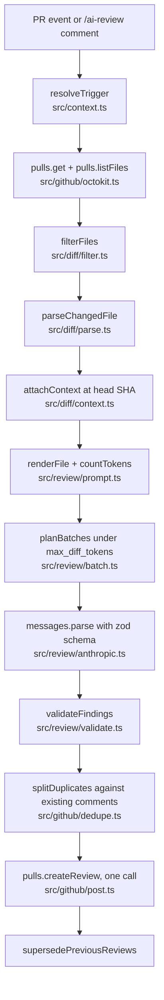

# Architecture

One run of the action reviews one pull request and ends with exactly one review posted (or a logged skip). Everything happens inside a single GitHub Actions job; nothing is stored between runs except what is on the PR itself.



## Modules

| Path | Responsibility |
| --- | --- |
| `src/main.ts` | Action entrypoint. Reads inputs, masks secrets, picks the provider, calls `runReview`, sets outputs. |
| `src/run.ts` | The pipeline. Pure orchestration over the `GitHubApi` and `ReviewProvider` interfaces so it is testable without the network. |
| `src/context.ts` | Decides whether the event is a reviewable `pull_request` or a `/ai-review` comment on a PR. |
| `src/config.ts` | Loads `.github/ai-review.yml`. Unknown keys warn; bad YAML or wrong types fail. |
| `src/cost.ts` | Price table per model and the cost estimate shown in every review. |
| `src/diff/filter.ts` | Drops lock files, binaries, generated output, `ignore` globs; enforces `max_files`. |
| `src/diff/parse.ts` | Unified-diff hunk parser. Records the new-file line number of every added line. |
| `src/diff/context.ts` | Up to 30 lines of the head-revision file around each hunk, never overlapping between hunks. |
| `src/review/prompt.ts` | The stable system prompt and the per-batch user message. |
| `src/review/batch.ts` | Greedy packing of rendered files into requests under `max_diff_tokens`. |
| `src/review/anthropic.ts` | The real provider: `messages.parse`, prompt caching, stop-reason handling. |
| `src/review/mock.ts` | Deterministic provider for tests, CI and local runs without a key. |
| `src/review/validate.ts` | Every finding must point at an added line in the diff; otherwise it becomes a file-level note. |
| `src/github/octokit.ts` | Thin Octokit adapter behind the `GitHubApi` interface. |
| `src/github/post.ts` | Review body (marker, severity table, verdict, usage, cost) and inline comment bodies with suggestion blocks. |
| `src/github/dedupe.ts` | Finding hashes, supersede logic for earlier bot reviews. |

## Data flow in detail

### 1. Trigger

`pull_request` (`opened`, `synchronize`, `reopened`) and `issue_comment` (`created`) are accepted. A comment counts only when its first word is `/ai-review` and the issue is a pull request. Anything else exits 0 with a log line. If the PR head lives in a fork, the run is skipped: on `pull_request` the token is read-only and the secret is absent, so there is nothing useful to do (see README, Design decisions).

### 2. Fetch and filter

`pulls.listFiles` is paginated (100 per page). Each entry carries a `patch` with the unified-diff hunks for that file, or no patch for binaries and diffs GitHub will not render. Files are filtered in order:

1. lock files by basename (`pnpm-lock.yaml`, `Cargo.lock`, …),
2. binaries by extension,
3. no patch (binary or too large), except pure renames which are reported as such,
4. generated globs (`dist/**`, `*.min.js`, `__snapshots__/**`, …),
5. `ignore` globs from the config,
6. `max_files` cut-off; everything past it is listed in the review as skipped.

### 3. Parse

`parsePatch` walks hunk headers `@@ -a,b +c,d @@` and tags each line as `add`, `del` or `context` with its old and new line numbers. `\ No newline at end of file` markers attach to the preceding line and consume no number. The set of added line numbers per file is the only place inline comments may land.

### 4. Context

For files that still exist at the head SHA, `repos.getContent` returns the full file (up to 1 MB). `attachContext` takes up to `context_lines` lines before and after each hunk. When two hunks are closer than twice that radius, the gap is split in the middle so no line is rendered twice. The rendered prompt labels these windows `CONTEXT (unchanged … not part of the diff)` and prints no `+`/`-` markers on them.

### 5. Batch

Every request is measured with `messages.countTokens` using the same model that will review it. The fixed part (system prompt plus PR header) is counted once; each rendered file is counted once; then files are packed greedily. A file that does not fit on its own is retried without context windows, and skipped with a reason if it still does not fit. Before each send the assembled request is counted again and split in half if it is over budget: the per-file sums are a plan, the final count is the check.

### 6. Review call

```ts
client.messages.parse({
  model,
  max_tokens: 16000,
  system: [{ type: "text", text: systemPrompt, cache_control: { type: "ephemeral" } }],
  messages: [{ role: "user", content: batchText }],
  output_config: { format: zodOutputFormat(ReviewOutputSchema), effort },
});
```

No `thinking` parameter (Claude Opus 5.5 thinks adaptively; `budget_tokens` is rejected), no forced `tool_choice` (structured outputs replace it). `stop_reason` is checked before `parsed_output`: `refusal` and `max_tokens` turn into an "incomplete" batch that is reported in the review body, and the action still exits 0. A response that cannot be parsed as the schema (what a truncated JSON looks like) is treated the same way.

### 7. Validate

Each finding must name a file that was reviewed and a line in that file's added-line set, and carry a known severity and category. Failures are not dropped: they are listed under "File-level notes" in the review body with the reason. Style findings are suppressed unless `style_comments: true`. Findings are sorted by severity and capped at `max_findings`; the overflow also becomes notes. Suggestions that merely repeat the original line, or that copied the prompt's `+     12 | ` prefix, are cleaned up.

### 8. Dedupe and supersede

Each inline comment ends with `<!-- ai-code-review:finding:<hash> -->`, where the hash covers file, line and normalised title. On every run the PR's existing review comments are scanned for these markers; a finding whose hash is already there is counted in the severity table but not posted again. After the new review is created, earlier reviews from this action (found by `<!-- ai-code-review -->`, not already marked superseded) are dismissed if they requested changes, or collapsed to a one-line stub if they were plain comments. GitHub does not allow dismissing a `COMMENTED` review, hence the two paths.

### 9. Post

One `pulls.createReview` with `commit_id` = head SHA, `event` = `COMMENT` (or `REQUEST_CHANGES` when `fail_on` is met), the body, and the inline comments (`line`, `side: "RIGHT"`). If GitHub answers 422 anyway, the same review is posted once more with the comments folded into the body, so the user still gets the findings.

## Failure modes and what the user sees

| Situation | Behaviour |
| --- | --- |
| No API key and `LLM_PROVIDER` is not `mock` | Action fails fast with a clear message. |
| Malformed `.github/ai-review.yml` | Action fails with the YAML error and path. |
| Fork PR on `pull_request` | Skipped with a notice; comment `/ai-review` from the base repo to review it. |
| Only lock files or binaries changed | Skipped; nothing is posted. |
| Model refuses or hits `max_tokens` on a batch | Review is posted with a "could not complete for some files" section; exit 0. |
| A batch is still over budget as one file | File is skipped and listed with its measured size. |
| GitHub rejects inline positions | Body-only review with the comments inlined as a list. |
| Findings at or above `fail_on` | Review uses `REQUEST_CHANGES` and the job fails. |

## Testing strategy

- Unit tests per module (`test/*.test.ts`) cover the parser, filter, context windows, validator, dedupe, config loader, batcher, trigger resolution and body rendering.
- The end-to-end test runs the full `runReview` pipeline against recorded `pulls.get` / `pulls.listFiles` / `repos.getContent` fixtures (`test/fixtures/pr-42`) with the mock provider, and asserts on the exact `createReview` call: one review, one comment, right path, right line, `side: RIGHT`, suggestion block and marker present. The same fixture is run twice to prove the dedupe and supersede paths.
- `pnpm eval` (`evals/run.ts`) runs the reviewer over small before/after cases with one planted bug each and scores whether the bug was reported on the exact line.
